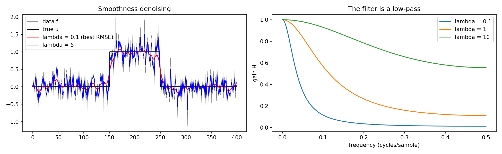

# 02 - Total-variation denoising (rROF) for gravitational-wave data

A step-by-step mathematical study of the **regularized Rudin-Osher-Fatemi (rROF)** denoising method and its use inside the **cWB** gravitational-wave search pipeline, with hand-written notes and small numerical experiments.

**Paper studied:** P. J. Barneo, A. Torres-Forné, J. A. Font, M. Drago, J. Portell, A. Marquina, *"Implementation of the rROF denoising method in the cWB pipeline for gravitational-wave data analysis"*, arXiv:2202.10465 (v2, June 2022). <https://arxiv.org/abs/2202.10465>

**Author of these notes and code:** Muskan Aman Khan

> **Status: in progress.** Steps 1-2 are complete (this README, notes, code and figure cover exactly these). Step 3 (total variation) is paused. See the [roadmap](#roadmap).
> This is a study of the mathematics, using a toy 1-D signal. It is **not** a reproduction of the paper's results on LIGO data.

---

## 1. What the paper does (in plain words)

Gravitational-wave detectors record data `f` that is the true signal `u` plus noise `n`:

$$f = u + n$$

The cWB pipeline searches for *unmodelled* signals ("bursts"), with no waveform template. The paper asks whether **removing noise first** (denoising) can make weak signals easier to see.

- It adds the rROF method (an L1 / total-variation method from image processing) to cWB as a plug-in that acts on the whitened data, in two variants: a **single-step** version and an **iterative** version.
- It tunes the method's five parameters (`h`, `β`, `λ`, `tol`, `N`) by comparing against a reference waveform, using a Wasserstein-type distance.
- It tests the combination on four real events: GW150914, GW151226, GW170817, GW190521.

What the paper reports (SNR computed by cWB; Table IV and Table II of the paper):

| Event | cWB only | cWB + iterative rROF | Change |
|---|---|---|---|
| GW150914 | 25.2 | 27.1 | +7.5% |
| GW151226 | 11.9 | 14.0 | +17.6% |
| GW170817 | 26.8 | 27.1 | +1.1% |
| GW190521 | 14.7 | 16.8 | +14.2% |

With the **single-step** rROF, the SNR of GW150914 *dropped* (25.2 to 15.5) because the method also removed the high-frequency part of the signal (the ringdown above roughly 150 Hz), and cWB did not report a detection for the other three events. The **iterative** version was introduced to fix this.

---

## 2. Mathematics covered so far (Steps 1-2)

### Step 1 - denoising as a trade-off

Fitting the data exactly ($u = f$) also fits the noise, so we add a *belief* about what a clean signal looks like. The paper's core equation (Eq. 3) is

$$u = \arg\min_u \Big[\, R(u) + \frac{\lambda}{2}\,F(u) \Big], \qquad F(u) = \|u - f\|_{L_2}^2$$

- $R(u)$: the **regularization (belief) term**. Small when $u$ looks plausible, large otherwise.
- $F(u)$: the **fidelity term**: how far $u$ is from the data.
- $\lambda > 0$: the **dial**. Large $\lambda$ means trust the data (little denoising, noise stays). Small $\lambda$ means trust the belief (strong denoising, risk of over-smoothing).
- The paper's whole subject is the *choice of $R(u)$*.

### Step 2 - the classical smoothness belief, and why it blurs edges

Choose $R(u)=\sum_i (u_{i+1}-u_i)^2 = \|Du\|^2$, where $D$ is the matrix of neighbor differences, $(Du)_i = u_{i+1}-u_i$. The objective is

$$J(u) = \|Du\|^2 + \frac{\lambda}{2}\|u-f\|^2$$

This is a convex quadratic, so its minimum is where the gradient vanishes:

$$2D^\top D\,u + \lambda(u-f)=0 \;\;\Longrightarrow\;\; u = \Big(I + \frac{2}{\lambda}D^\top D\Big)^{-1} f$$

This is the discrete form of the Euler-Lagrange equation $\Delta u + \lambda(f-u)=0$ in the paper (Eq. 5), where a constant factor is absorbed into $\lambda$.

**Signal-processing view.** The solution is a **linear low-pass filter**. For periodic edges, frequency $\nu$ (cycles per sample) is multiplied by

$$H(\nu) = \frac{1}{1 + \frac{2}{\lambda}\,4\sin^2(\pi\nu)}$$

so slow components pass ($H\approx 1$) and fast components are suppressed. A **sharp edge** (or a sudden gravitational-wave feature) is made of fast components, so this filter **blurs it**. That is the motivation for replacing the squared jump by the absolute jump (total variation), which is Step 3.

---

## 3. Experiment: smoothing a noisy box (`code/rrof_step2.py`)

Setup: a clean box signal of 99 samples at height 1 inside 400 samples (two sharp edges), plus white Gaussian noise with $\sigma = 0.3$ (fixed seed 0).

What the script prints and shows:

- Shape of $D$ is `(399, 400)`; the clean box has exactly two non-zero jumps (positions 150 and 249, values $+1$ and $-1$).
- The belief term is $R(u_{\text{true}}) = 2.0$ for the clean box but $R(f) \approx 72.9$ for the noisy data, so $R$ rewards clean signals.
- Root-mean-square error (RMSE) of the denoised signal against the true box, for different $\lambda$:

| $\lambda$ | RMSE |
|---|---|
| raw data $f$ | 0.299 |
| 0.01 | 0.140 |
| 0.1 | **0.103** |
| 0.5 | 0.117 |
| 1 | 0.134 |
| 5 | 0.197 |
| 20 | 0.254 |
| 100 | 0.288 |
| 1000 | 0.298 |

Reading the table: the error is lowest at $\lambda = 0.1$. For large $\lambda$ it returns to the raw-data level (nothing is denoised: leftover noise, "variance"). For very small $\lambda$ it rises again because the signal itself is distorted (rounded edges, flattened top: "bias"). This is the **bias-variance trade-off**.



*Left: noisy data (gray), true box (black), smoothed with $\lambda=0.1$ (red) and $\lambda=5$ (blue); no single $\lambda$ gives flat regions and sharp edges. Right: the filter gain $H(\nu)$ for several $\lambda$ (a low-pass).*

### How to run

```bash
pip install numpy matplotlib
cd code
python rrof_step2.py
```

The script prints the numbers above and saves `figures/step2_smoothing.png`. (It also opens plot windows: close the first one to let the script continue.)

---

## 4. Contents of this folder

```
02_tv_denoising_rROF_cWB/
├── README.md                          this file
├── code/
│   └── rrof_step2.py                  Steps 2.1-2.4: box signal, matrix D, smoothing solve, plots
├── figures/
│   └── step2_smoothing.png            output of rrof_step2.py
└── notes/
    └── Initial Notes_rROF_cWB.pdf     8 handwritten pages
```

**Notes (`notes/Initial Notes_rROF_cWB.pdf`).** Handwritten notes covering: the problem overview and the model $f=u+n$; the $L_2$ norm and the paper's Eq. 1; why $u=f$ is a useless denoiser; the core Eq. 3 with the roles of $R(u)$, $F(u)$ and $\lambda$; the classical smoothness belief $R(u)=\sum_i(u_{i+1}-u_i)^2$; the objective $J(u)$ and its minimizer; the low-pass-filter interpretation; and why it blurs the sharp edges that gravitational-wave signals contain.

---

## 5. Roadmap

| Step | Topic | Status |
|---|---|---|
| 1 | Problem, model, core equation (Eq. 1-3) | done |
| 2 | Smoothness (Tikhonov) denoising; low-pass view (Eq. 4-5) | done |
| 3 | Total variation / ROF: absolute jumps keep edges (Eq. 6-8) | paused |
| 4 | Regularized rROF and how it is solved (Eq. 9) | planned |
| 5 | Iterative rROF: adding the residual back, stopping rule | planned |
| 6 | Parameter tuning and the distance measure (Eq. 10) | planned |
| 7 | The cWB pipeline, results, critique and open questions | planned |

---

## 6. Questions I want to investigate (not claims)

These come from reading the paper; they are to be checked in later steps.

1. **Blind use.** The parameters in Table I are tuned per detector using a reference waveform, and the iterative parameters in Table III are chosen by hand per event. How would they be set on data whose signal is unknown?
2. **Evidence of improved detection.** Success is judged by the SNR cWB reports on four known events. A detection claim needs the false-alarm behavior on background data. A nonlinear denoiser may change the noise statistics. The paper lists a full O1-O3 re-analysis as future work.
3. **Why does iteration fix the high-frequency loss?** The single-step method acts like a low-pass filter and loses the ringdown; the iterative version recovers it empirically. Can this be explained, for example in the frequency domain, with a principled stopping rule?
4. **Convergence.** The paper notes the minimization "may diverge in some situations" depending on the tolerance. Under what conditions does the Gauss-Seidel scheme for the $\beta$-smoothed problem converge?
5. **Notation check.** Eq. (10) is named a Wasserstein distance but is written as $\int |f(t)-u(t)|\,dt$, which is an $L_1$ distance between the two time series. To verify against the cited references.
6. **Eq. (11)** for the effective amplitude $\rho$: to check against the cWB documentation.

---

## 7. References

- P. J. Barneo et al., arXiv:2202.10465 (2022). *Paper studied.*
- L. I. Rudin, S. Osher, E. Fatemi, "Nonlinear total variation based noise removal algorithms", Physica D 60, 259 (1992). *Original ROF model (reference [19] in the paper).*
- C. R. Vogel, M. E. Oman, "Iterative methods for total variation denoising", SIAM J. Sci. Comput. 17, 227 (1996). *Regularized ROF algorithm (reference [31]).*
- S. Osher, M. Burger, D. Goldfarb, J. Xu, W. Yin, "An iterative regularization method for total variation-based image restoration", Multiscale Model. Simul. 4, 460 (2005). *Iterative regularization (reference [33]).*
- S. Klimenko et al., Phys. Rev. D 93, 042004 (2016), and M. Drago et al., SoftwareX 14, 100678 (2021). *The cWB pipeline (references [23, 24]).*

*Reference details are copied from the paper's own reference list; check them against the original publications before citing them elsewhere.*
